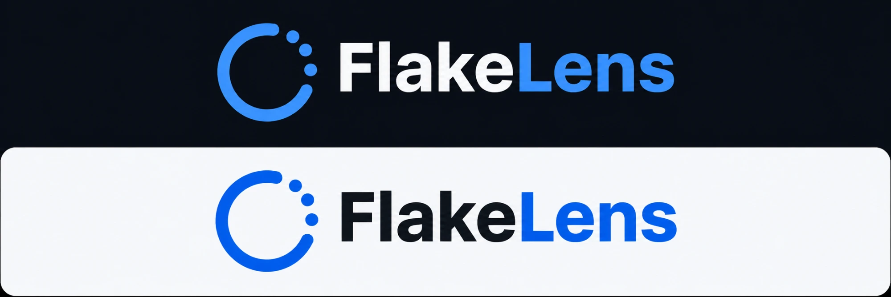

# Flaky Test Triage Assistant: Project Spec



Working name: **FlakeLens** (placeholder) · Drafted 19 Nov 2026 · Updated 19 Nov 2026 with planning decisions (section 20.1) · Companion to the portfolio ideas doc

## 1. Summary and decisions

A free, local-first web app. You drop in test results from several CI runs (Playwright JSON, JUnit XML). It ranks which tests are flaky, groups their failures, and explains the likely cause, using rules first and an optional LLM second. Everything runs in the browser, so hosting costs $0 and logs never leave the user's machine by default.

| Decision | Choice |
| --- | --- |
| Platform | **Web app (installable PWA).** Not mobile, not an extension (see section 7). |
| Online or offline | **Offline-first.** Online only for optional cloud LLMs and optional GitHub fetch. |
| Backend | **None.** Static site on GitHub Pages, data in the browser (IndexedDB). |
| LLM | Tiered: rules only, then in-browser model, then Ollama or LM Studio, then bring-your-own free API key. |
| Beachhead users | SDETs and developers using **Playwright** in CI, then JUnit-based stacks. |
| Cost | $0. Public repo, so GitHub Actions minutes are unlimited. |
| MVP input | **Playwright JSON only.** JUnit XML is the first v1 feature. |
| Stack basics | React, TypeScript, Vite, npm. MIT license. |
| Schedule | No deadline. Continuous development, flexible hours. Progress is gated by quality gates, not dates. |

## 2. Problem

Flaky tests pass and fail on the same code, and teams cope by re-running, which hides the problem and burns CI time.

- Surveys confirm flaky tests are common and serious. Developers say the hard parts are reproducing them and finding the cause ([ICST 2022](https://arxiv.org/abs/2203.00483), [Palomba et al.](https://dibt.unimol.it/staff/fpalomba/documents/C46.pdf)).
- Playwright labels a test flaky only when it fails and then passes on retry, and retries are off by default ([TestDino](https://testdino.com/blog/playwright-flaky-tests-fix), [itechguides](https://www.itechguides.com/?p=869862)). Flakiness that shows up across separate runs is invisible in a single report.
- Most teams have no inventory of which tests are flaky, only a vague sense ([DEV Community, tool author](https://dev.to/promode/i-built-an-open-source-cli-to-detect-flaky-tests-heres-what-i-learned-982); anecdotal).
- Research finds about 75% of flaky tests (184 of 245) were already flaky when added, so new tests deserve extra attention ([longitudinal study](https://par.nsf.gov/biblio/10601348-large-scale-longitudinal-study-flaky-tests)).
- Developers want clear root-cause explanations before they trust an automated fix ([FlakyGuard](https://arxiv.org/html/2511.14002v1)).

## 3. Goal and aim

**Aim:** turn a pile of CI test results into a ranked, explained list of flaky tests in under two minutes, with no account, no install and no data upload.

**Goals**

1. Detect flaky tests from run history, separating confirmed flakiness (same commit, different result) from unproven tests (could be real regressions).
2. Group failures that share a cause, so 200 red tests become a handful of fingerprints.
3. Classify the likely cause (timing, order dependency, shared state, network, environment, locator) with evidence lines from the logs.
4. Rank by wasted CI time, so the user knows what to fix first.
5. Export a report (markdown, CSV, JSON) a team can paste into a ticket.

**Non-goals for v1:** running tests, auto-fixing code, auto-quarantine, team accounts, cloud sync, dashboards that need a server.

**Portfolio goals:** publish measured accuracy on a labeled test set, and keep the project's own test suite and CI clean and fast.

## 4. Target users and launch audience

Start narrow: **Playwright users** who run tests in CI. Playwright has a built-in JSON reporter and a flaky label, so the input is easy to get ([Playwright reporters](https://mintlify.com/microsoft/playwright/api/reporters)). JUnit XML comes second, because it covers Java, Python, .NET and most other stacks.

| Persona | Pain | What they get | Evidence level |
| --- | --- | --- | --- |
| SDET / QA automation engineer on a small team (primary) | Re-runs, no flaky inventory, manager asks why CI is red | Ranked list plus a report to share | Strong (research above) |
| Developer who owns CI at a startup or open-source project | No time to dig through logs | Failure groups and probable cause | Moderate |
| QA learner or bootcamp student | Does not know the flaky taxonomy | Built-in sample cases that teach each cause | Hypothesis, test it |
| QA team that cannot upload client logs to a third-party service | Compliance and privacy | Nothing leaves the browser by default | Hypothesis, test it |

**If you launch soon:** announce first to QA communities you already belong to, then to wider testing communities, then to developer forums. Candidates are Ministry of Testing, r/QualityAssurance, r/softwaretesting, the Playwright community, Dev.to and LinkedIn. Add local QA groups in the Philippines. Show HN and Product Hunt can wait until the demo is polished.

## 5. Competitive landscape and positioning

Paid and freemium tools already exist, so the pitch is not "first". The gap to test is **local-first, no account, no CI integration required**.

| Tool | Model | Notes |
| --- | --- | --- |
| BuildPulse | Per-repo subscription | From $50/month, no free tier, requires a JUnit XML upload step in CI, per a competitor's comparison ([Kleore](https://dev.to/byteframe/kleore-vs-alternatives-honest-comparison-4gpa), vendor source, verify) |
| Trunk Flaky Tests | Free tier with limits | Needs the Trunk CLI in CI ([Kleore](https://dev.to/byteframe/kleore-vs-alternatives-honest-comparison-4gpa)) |
| Mergify Test Insights | Free for open source and small teams | Ranks tests by historical instability and shows traces ([Mergify](https://articles.mergify.com/how-to-get-rid-of-flaky-tests-lethal-tools/)) |
| TestDino | Playwright-focused | Root-cause classification, PR-tied runs ([TestDino](https://testdino.com/compare/buildpulse-vs-testdino)) |
| Datadog Test Visibility | Part of a larger platform | Good if you already use Datadog ([Kleore](https://dev.to/byteframe/kleore-vs-alternatives-honest-comparison-4gpa)) |
| ReportPortal, Allure TestOps | Self-hosted or enterprise | Reporting with history and clustering ([TestDino](https://testdino.com/blog/flaky-test-detection)) |

**Positioning:** "Drop your CI results into a page, get a ranked flaky list and likely causes. Nothing is uploaded." Several comparison pages are written by competing vendors, so treat their claims as leads and check each tool yourself before you publish any comparison.

**Differentiators to prove:** zero setup, privacy by default, rules-based classification that works with no LLM, an evidence check on every AI explanation, and a published accuracy report.

## 6. Scope by release

| Release | Features | Done when |
| --- | --- | --- |
| **MVP** | Import Playwright JSON (drag and drop, multiple files). Optional commit or label per file. Test identity and run history. Flakiness score with confirmed and unproven labels (flaky detector only). Ranked table. "Try sample data" button built from flake lab runs. | A stranger can reach a ranked list in under 2 minutes, and the MVP gate in section 18 passes |
| **v1** | JUnit XML importer (first v1 feature). Real-data check of the flaky detector (section 11.1). Failure fingerprinting and grouping. Rule-based cause classifier. Test detail page with run timeline and log viewer. Correlation by browser, shard, OS and time. Markdown, CSV and JSON export. PWA install and offline use. | Works fully offline, accessibility pass done |
| **v1.5** | LLM explanations (in-browser, Ollama, LM Studio, bring-your-own key). Redaction preview. Evidence verifier. Evaluation report in the README. | Published accuracy numbers |
| **v2 ideas** | Phase two detectors (falsely passing and falsely failing, section 11.1). CTRF, Jest and Cypress importers. Order-dependence helper that suggests bisect commands. GitHub public-repo run import. Optional CLI that emits the canonical JSON. Browser extension for GitHub Actions pages. | Only if users ask |

### 6.1 Build order

Steps are numbered so other sections can refer to them ("step four", "step five").

| Step | Work | Phase |
| --- | --- | --- |
| 1 | Foundation: repo, Vite + React + TypeScript strict, lint, Vitest, CI, folder boundary for the analysis engine | MVP |
| 2 | Canonical data model and Playwright JSON importer, with the import rules in section 9.1 | MVP |
| 2a | Flake lab, first cut: the tiny static HTML app and its Playwright tests, run many times, result files saved as fixtures. Needed before step 3 (test data) and step 4 (sample data). | MVP |
| 3 | Flaky scoring engine and labels (section 11), thresholds in one config file | MVP |
| 4 | Ranked table and sample data (section 13.2) | MVP |
| 5 | Failure fingerprinting and rule-based cause classifier | v1 |
| 6 | Provider adapter (LLM tiers, section 12) | AI and eval |
| 7 | Flake lab expansion and the evaluation report (section 17) | AI and eval |

Other v1 work (JUnit importer, test detail page, correlations, export, PWA) is scheduled after step 5, in the order listed in section 6.

## 7. Platform decision

**Decision: web app, installable as a PWA.** Reasons, in order of weight:

1. **Where the work happens.** Test triage is a desk task with big logs and tables. A phone screen is a poor fit.
2. **Zero distribution cost.** A web app on GitHub Pages needs no store review and no developer account. As far as I know, Apple charges a yearly developer fee, so check before planning any native app.
3. **Privacy story.** Files read in the browser never leave the machine, which is the main differentiator.
4. **Demo-ability.** One link works for recruiters and users alike.

**Why not mobile:** low value for this task, plus store fees and review time. A read-only mobile view of an exported report is a cheap later add-on, not a core platform.

**Why not an extension first:** an extension would need to read GitHub Actions pages or CI artifacts, which breaks easily and limits you to one site. It is a good v2 add-on that hands data to the web app.

**CLI companion: out of scope.** The QAEOps CLI is a separate project and is not part of FlakeLens. A generic CLI that emits the canonical JSON stays a v2 idea only.

## 8. Architecture

A four-stage pipeline runs in the browser: ingest, normalize, analyze, explore. The only parts that can reach outside the tab are the optional LLM paths.

```text
  Files (Playwright JSON; JUnit XML in v1)
        |
        v
  [1 Ingest]     Web Worker: size and depth caps, parse, Zod validation, notices
        |
        v
  [2 Normalize]  Run / Test / Attempt / Failure records
        |
        v
  [3 Analyze]    scoring, labels, fingerprints, rule classifier   <---->  IndexedDB (Dexie):
        |                                                                 records, results,
        v                                                                 LLM answer cache
  [4 Explore]    React UI: ranked table, detail, export
        :
        : optional, off by default (the only paths that leave the tab)
        +--> a. in-browser model (WebLLM / Transformers.js)
        +--> b. local engine on localhost (llamafile, Ollama, LM Studio)
        +--> c. bring-your-own cloud key (after redaction preview)
```

Data flows left to right. Analysis results and cached LLM answers live in IndexedDB, so a reload or an offline session loses nothing.

**Design rules**

- **Parse in a Web Worker** so large files never freeze the page. The browser's DOMParser is not available in workers, so use a JavaScript XML parser for JUnit.
- **Deterministic first.** Scoring, grouping and the rule-based classifier work with no model at all. The LLM only words the explanation and suggests fixes.
- **No network by default.** There is no analytics, no font CDN and no API call until the user opts in.
- **Provider adapters share one interface** (OpenAI-compatible chat, streaming, JSON output), so adding a provider is one small file.
- **Cache by failure fingerprint and prompt version**, so the same failure is never sent twice. This matters most on free-tier daily caps.

## 9. Data model and input formats

Every importer converts its format into the same four records, so analysis code never sees a vendor format.

| Record | Key fields | Notes |
| --- | --- | --- |
| **Run** | runId, importId, commit SHA or label, branch, timestamp, runner, shard, browser, OS | Taken from the file, the CI environment block, or entered by the user. Missing fields stay empty. runId = hash of the report's `stats.startTime` plus the file contents, so the same file imported twice is detected. **Commit default:** each imported file counts as its own commit unless the user types a commit or label for it; files with the same commit or label are grouped. Confirmed flakiness then comes from retries by default. |
| **Test** | testId, testKey, file, suite path, title, project | testId = hash of file + suite path + title + project. testKey = hash of file + suite path + title (no project), used to compare one test across browsers or projects in the v1 correlation feature. A rename shows up as a new test unless merged by similarity (section 10). |
| **Attempt** | runId, testId, retryIndex, status, durationMs | One row per attempt, so a retry is not counted as a separate test. |
| **Failure** | attemptId, message, stack, log lines, fingerprint | Fingerprint is computed after masking noise (section 10). |
| **Import** | importId, file name, imported at, result (success, partial, failed), counts (found, imported, not imported), notices, runIds | One per imported file, including failed imports (which create no runs). Each Run links back to its importId. Feeds the Loaded data screen; deleting an import removes its runs and their attempts. |

**Input formats**

- **Playwright JSON:** read `suites[*].specs[*].tests[*].results[*]`. Each result has a status and a retry number ([reporter docs](https://manimovassagh.github.io/samtest/docs/reference/reporters)). A test that passed after a retry is flaky within that run ([TestDino](https://testdino.com/blog/playwright-flaky-tests-fix)).
- **JUnit XML:** testsuite, testcase, failure, error and skipped elements. Some Java runners add rerun elements. Check the runner's output before relying on them.
- **CTRF JSON:** a common test-report schema with a Playwright reporter ([CTRF reporter](https://npmjs.com/package/playwright-ctrf-json-reporter)). Good v2 importer.

Tell users to run Playwright with `--repeat-each` for a quick stress sample ([TestDino](https://testdino.com/blog/playwright-flaky-tests-fix)).

### 9.1 Import rules: bad and partial input

The importer never throws to the user. Every import returns a result that is either a success with records and notices, or a failure with a clear reason. The page keeps working in every case.

**Principles**

- **Validate at the boundary.** Every file is checked against a schema before any analysis runs. Nothing downstream sees unvalidated data.
- **Keep the good, skip the bad.** If part of a file is unusable, import the clear records, skip the rest, and tell the user what happened.
- **Say it plainly.** Messages name the problem in plain words and say where it is (test name, position in the file). No stack traces or internal codes.
- **Never guess silently.** A missing field is left empty, not invented. A record that cannot be trusted is left out (not imported) and counted.

**Result shape (conceptually)**

- Status: success, partial, or failed
- Records: runs, tests, attempts and failures that passed validation
- Counts: tests found, imported, not imported
- Notices: a list of problems, each with a severity, a reason code, a plain-language message and a location

**Handling by case**

| Case | Result | Message to the user |
| --- | --- | --- |
| Valid file | Success | Imported N tests from M runs. |
| A few tests have a missing status, name or duration | Partial | Imported N tests. X not imported: reason. Download the not-imported list. |
| Unreadable duration or date on some results | Partial, field left empty | Y results had an unreadable duration and were kept without it. |
| Duplicate test IDs in one run (for example parameterized tests with the same title) | Partial or success | IDs made unique using the project name and an index. Shown as a notice. |
| Same run imported twice | Success, de-duplicated | This run was already loaded and was not counted twice. |
| Missing run metadata (commit, branch, browser) | Success, fields empty | No commit info found. Cross-commit evidence will be limited. |
| File is the wrong format | Failed | This does not look like a Playwright JSON report. |
| Empty, truncated or invalid JSON or XML | Failed | The file could not be read. It may be cut off. |
| More than half the records are bad | Failed | Too much of this file is unclear to analyse it reliably. |
| File too large or too deeply nested | Failed | The file is larger than the limit of X. Try fewer runs. |
| Hostile content (script tags, injection text, entity tricks) | Success or partial | Imported as plain text. Nothing is run or rendered as HTML. |

The "more than half" cut-off is a starting value, tuned on the test fixtures. It exists because scores built from a small fragment of a file could mislead.

**Notice design**

- A short banner after import: counts first, then up to three example problems.
- An expandable list of all notices, and a download of the not-imported list as CSV or JSON for debugging.
- Notices stay visible on the dashboard so the user knows what the ranking is based on.

**Tests for these rules (all run in CI)**

- One fixture per row of the table above, each with the expected status, counts and message.
- Property tests: any mutated valid file either imports or fails with a notice, and never throws.
- Fuzz test on the parsers with random and corrupted input.
- A golden test that not-imported plus imported counts always equal the tests found.

## 10. Data structures and algorithms

The project is a good place to show real DSA, because each problem maps to a known technique. Every row below is small enough to implement and test on its own.

| Problem | Technique | Why it fits |
| --- | --- | --- |
| Look up a test's history fast | `Map<testId, TestStats>`, plus per-test ring buffer of the last N outcomes | O(1) lookup and bounded memory |
| Count flips between pass and fail | Store outcomes as bits. Flips = popcount of `(x XOR (x >> 1))` masked to the lowest n-1 bits | Constant-time per word, easy to property-test. JavaScript bitwise operators are 32-bit, so the ring buffer holds at most 32 outcomes per word (or use BigInt). |
| Rank the top K offenders | Min-heap of size K | O(n log K), no full sort while filtering |
| Group failures by cause | Normalize the message (mask numbers, hex, UUIDs, timestamps, paths, ports), then hash it into a fingerprint | O(length) per failure, exact grouping |
| Merge near-duplicate groups | Token shingles with Jaccard similarity, optionally MinHash, merged with union-find | Handles messages that differ by one variable |
| Extract log templates | A fixed-depth parse tree in the style of the Drain log parser | Turns raw log lines into reusable templates |
| Match renamed tests | Edit distance (dynamic programming) on titles, with a threshold, within the same file | Keeps history across renames |
| Find when a test became flaky | Change-point detection on the failure series (CUSUM or binary segmentation) | Points to the commit range to inspect |
| Does failure depend on browser, shard, OS or hour? | 2x2 contingency table with Fisher's exact test, or chi-square for larger tables | Reports an effect size, not just a flag |
| Find order-dependence suspects | For failing runs, compare the set of tests that ran earlier on the same worker with passing runs, ranked by lift | Produces a short suspect list to confirm with bisection |
| Keep LLM calls inside free limits | Token bucket for rate, priority queue by impact, exponential backoff with jitter, circuit breaker per provider | Respects per-minute and per-day caps |
| Never resend the same failure | LRU cache keyed by fingerprint + prompt version, persisted in IndexedDB | Biggest saver of free-tier requests |
| Smooth scrolling in huge lists | Windowed (virtualized) rendering | O(visible rows) |
| Search tests and logs | Inverted index (a small library such as MiniSearch is fine) | Instant filter as you type |

**Why order-dependence needs a human step:** the browser tool cannot rerun tests. The app ranks suspects and prints the commands for a delta-debugging bisect, and the user runs them locally. iDFlakies uses a similar idea: it reruns tests in different orders and classifies a flaky test as order-dependent or not ([Illinois software and data](https://mir.cs.illinois.edu/winglam/software.html)).

**New-test watch:** because about three quarters of flaky tests are flaky when added ([longitudinal study](https://par.nsf.gov/biblio/10601348-large-scale-longitudinal-study-flaky-tests)), highlight recently added tests that already show any mixed outcome.

## 11. Flakiness scoring spec

The score separates **evidence** (same commit, different result) from **suspicion** (a pattern that could also be a real regression). Weights below are starting values to calibrate on the labeled test set.

**Definitions, per test, over its chronological attempts**

- commit = the commit SHA or user-typed label; by default each imported file is its own commit (section 9)
- attempts are ordered by run timestamp, then retryIndex; runs without a timestamp keep file import order
- m = number of commits where the test both passed and failed (a pass after a retry in the same run counts)
- g = number of commits with at least two attempts
- f = flip rate = pass/fail transitions divided by (attempts minus 1)
- r = recency-weighted failure rate (exponential moving average)

```latex
S = 100 \times \left( 0.60\, W(m, g) + 0.25\, f + 0.15\, 4r(1-r) \right)
```

W(m, g) is the lower bound of the Wilson 95% interval for the proportion m / g (W = 0 when g = 0), which keeps a test with 1 of 2 commits from outranking one with 8 of 20. The term 4r(1-r) is 0 for tests that always pass or always fail and peaks at a 50% failure rate, so a consistently broken test is not called flaky.

**Labels**

Rules are checked in this order; the first match wins.

| Order | Label | Rule |
| --- | --- | --- |
| 1 | Not enough data | Fewer than 3 attempts in total, or a single run with no retries. Exception: if m is at least 1 (for example a pass after a retry), skip this rule, because that is direct evidence. |
| 2 | Consistently failing | Failure rate at or above 95% over the last attempts. Likely a real bug, not flakiness. If m is at least 1, the row also shows a "was flaky earlier" note, so a real regression stays visible. |
| 3 | Confirmed flaky | m is at least 1. A pass after a retry is direct evidence, so it counts even in a single run. |
| 4 | Unproven | m is 0, at least 5 attempts, and f is at least 0.2 |
| 5 | Stable | Everything else |

**New and mixed** is a tag added on top of the label: a test first seen in the loaded history that already shows mixed outcomes.

All thresholds here (95%, 3 attempts, 5 attempts, 0.2) and the import cut-off in section 9.1 are starting values. They live in one config file with tests, so tuning on the flake lab is visible in the history.

**Priority for fixing**

```latex
\text{priority} = \frac{S}{100} \times \text{wasted minutes}
```

Wasted minutes = total duration of failed attempts on commits where the same test also passed. This is the number to show a manager: it turns flakiness into CI time lost.

**Default sort (by group, then priority):** Confirmed flaky first (by priority), then Unproven (by score), then Consistently failing, then Stable, then Not enough data. Unprovens have no confirmed wasted minutes by definition, so they show "possible wasted time" (the duration of their failed attempts), labeled as an estimate. Attempts with no duration count as 0 minutes and the row says the duration is unknown.

**Edge cases to test:** a single run (no history, so only retry-based evidence), tests that skip on some browsers, parameterized tests with the same title, retries disabled, and runs from different branches mixed together.

## 11.1 Three detectors: flaky, falsely passing, falsely failing

The scoring engine answers one question about each test: can its result be trusted? Flakiness is only one way a result can be wrong. The engine runs three independent detectors. Each returns a label, a confidence level, and the evidence behind it. None of them claims to know the truth. They flag results a human should check.

**Build order (decision): flaky detection first.** Only the flaky detector is in the MVP. The falsely passing and falsely failing detectors are **phase two** and start only after the flaky detector passes its definition of done below. Their design stays in this section so the data model and the shared detector output can be built to carry them later.

**Definition of done for the flaky detector**

1. All unit and property tests pass, including the scoring edge cases in section 11.
2. Every case in the flake lab gets its known label.
3. All hostile, broken and partial input tests from sections 9.1 and 19.1 pass with no unhandled error.
4. Precision and recall are measured and published, at several history lengths (section 17).
5. The results are checked on messier real-world data (for example the public flaky-test datasets in section 16), not only on our own lab. A perfect score on a small lab alone is not evidence, so this step is required before calling it done. **Split by phase:** the MVP gate uses the flake lab only. The real-data check moves to v1, because the public Maven dataset needs the JUnit importer. Real suite data is used only if it is anonymized and permission is given, especially anything from work.
6. A review by you as the SDET: you try to break it and the list of findings is closed.

Until all six hold, the other two detectors are not started.

| Detector | What it finds | Typical cause | Run-history needed |
| --- | --- | --- | --- |
| **Flaky** | Same code, different results | Timing, order, shared state, environment | Several runs |
| **Falsely passing** | Test is green but the feature may not be working or even present | Missing assertions, weak checks, mocks covering real behavior, tests that skip work | One run helps, history helps more |
| **Falsely failing** | Test is red but the product may be fine | Bad locator, stale test data, broken environment, wrong expectation | One run helps, history helps more |

The flaky detector is specified in section 11. The two new detectors are described below. All three share the same output shape, so the UI and exports treat them alike.

**Detector output (conceptually)**

- Test ID and the detector name
- Label (for example Unproven, Likely, Confirmed)
- Confidence: low, medium or high, with the signals that raised it
- Evidence: the specific records and log lines behind each signal
- Suggested next step, phrased for a human to check

**Falsely passing: signals**

The signals come from report data only. No signal proves a false pass. The detector labels a result "suspiciously passing", never "broken".

| Signal | Why it matters |
| --- | --- |
| Test has no assertions or no checks recorded in its steps | A test that checks nothing cannot fail |
| Passes far faster than its own history | Work may have been skipped |
| No screenshot, trace or video where its peers have one | Evidence of the UI state is missing |
| Steps marked skipped or never reached inside a passing test | The test did not do what its title says |
| Never failed across a long history, while code around it changed often | Possible weak check, medium suspicion only |
| Passes while related tests on the same page or feature fail | Coverage disagrees with itself |
| Test only checks that an element exists, or only a status code | Shallow check, flagged as advice |

Two or more signals raise confidence. A single signal stays low. Some of these signals depend on how rich the report is: Playwright's JSON can include steps, attachments and annotations, while a bare JUnit file carries much less. When data is missing, the detector says it could not check, rather than staying silent.

**Falsely failing: signals**

| Signal | Why it matters |
| --- | --- |
| Many unrelated tests fail with the same normalized error at the same time | Points at the environment or a shared dependency, not at each test |
| Failure is a timeout or missing element, on one browser, shard or machine only | Likely locator, timing or environment problem |
| Fails, then passes on rerun with the same commit | Result changed with no code change |
| Error message mentions network, DNS, connection refused, 5xx or a service outage | Infrastructure, not the product |
| Fails on stale or expired test data (for example an account that already exists) | Test setup problem |
| Test failed on the first run after a long green history, with no related code change in the commit | Possible environment or data change |
| Assertion compares against a value that looks time-dependent or hard-coded | Brittle expectation |

The detector separates "environment event" (many tests, one cause) from "test problem" (one test, repeated). Environment events collapse into a single group on the dashboard, so 200 red tests read as one incident.

**How the detectors interact**

- A test can carry more than one label. Example: flaky and falsely failing at once.
- Priority for fixing uses the same wasted-minutes idea as section 11, plus a **trust impact** line: how many results in the loaded history cannot be trusted.
- A real regression must stay visible. A test that fails every run, starting at one commit, is labeled "consistently failing" and never softened into a false failure unless the environment signals are strong.

**What each label tells the user**

| Label | Plain-language message |
| --- | --- |
| Confirmed flaky | This test gave different results on the same code. |
| Suspiciously passing | This test passed, but there are signs it may not be checking much. Worth a manual look. |
| Possibly false failure | This test failed, but the pattern points at the environment or the test itself. Check before filing a bug. |
| Environment event | Many tests failed for the same reason at the same time. Likely one cause. |
| Cannot check | This report does not include enough detail to check this signal. |

**Limits, stated honestly**

- A report cannot prove that a feature is missing from the product. Only a person or a separate check can. The tool narrows where to look.
- Rich signals (steps, screenshots, assertions) depend on the reporter configuration. The setup screen should explain how to get the richer data from Playwright.
- Every threshold above is a starting value, tuned on the flake lab.

**Flake lab additions for the new detectors**

- **False pass cases:** a test with no assertions, a test that checks only that a page loads, a test where the feature button is missing but the check is on a wrapper element, and a test that was marked passing after a skipped step.
- **False failure cases:** a bad locator after a harmless markup change, an expired test account, a service outage that fails 30 tests at once, and a hard-coded date that expires.
- Each case has a known label, so we measure precision and recall per detector (section 17).

**Tests for the detectors**

- One fixture per signal, with the expected label, confidence and evidence.
- Property tests: adding an unrelated passing test never changes another test's labels; shuffling input order never changes results.
- Over-flagging tests: healthy, well-checked tests with rich evidence must stay unlabeled.
- A "cannot check" test for each signal when its data is missing.

## 12. LLM providers and prompt design

The app works with no model at all. Each tier below adds quality and some friction, and the user picks one. An auto-detect step can ping the local ports and show which providers are reachable.

| Tier | Provider | Setup | Quality | Privacy and limits |
| --- | --- | --- | --- | --- |
| 0 | **Rules only** | None | Good for common patterns (timeouts, selectors, order, network) | Fully local |
| 1 | **In-browser model** (WebLLM, Transformers.js) | One-click model download, WebGPU needed for WebLLM | Small models, weaker reasoning | Fully local. WebLLM runs on WebGPU with an OpenAI-style API; Transformers.js adds a WASM CPU fallback ([Pinggy](https://pinggy.io/blog/run_llm_in_browser_webgpu/)) |
| 2 | **Ollama or LM Studio** | User installs the tool and downloads a model. Needs CORS allowed for the site. Default ports are 11434 (Ollama) and 1234 (LM Studio). See section 12.1 for the packaged setup. | Best local quality | Fully local, bigger models. Technical users only. |
| 3 | **Bring-your-own free API key** (Groq, OpenRouter, Gemini) | Paste a key, kept in the browser only | Good | Data leaves the machine. See limits below. |

**Free-tier limits seen in Oct to Nov 2026 sources (verify before relying on them)**

- Groq: 30 requests/min on gpt-oss-120b with 1,000 requests/day and 200K tokens/day ([Apidog](https://apidog.com/blog/free-ai-api/)). The 8B model allows 14,400 requests/day and 500K tokens/day ([Aireiter](https://aireiter.com/blog/best-free-ai-api)).
- OpenRouter `:free` models: 20 requests/min and 50 requests/day, or 1,000/day after a one-time $10 credit purchase ([Requesty](https://www.requesty.ai/blog/free-llm-apis)).
- Gemini free tier: content may be used to improve Google products ([Requesty](https://www.requesty.ai/blog/free-llm-apis)). Warn users and redact first.

**Chrome's built-in model** is desktop Chrome only, so treat it as a bonus, not a tier ([J.A. Watte](https://jwatte.com/blog/in-browser-llm-byo-model-cross-browser.md)).

### 12.1 When free API caps are not enough: a no-cap local fallback

The free cloud tiers above are the weak spot: daily caps of 50 to 1,000 requests can run out. A local model has no cap, but asking users to install Ollama, pull a model and fix CORS is too much friction. So the app needs **packaged local paths**, plus a way to spend fewer requests in the first place.

**Paths that avoid caps, from least to most setup**

| Path | What the user does | Caps | Trade-offs |
| --- | --- | --- | --- |
| **A. In-browser model** (already Tier 1) | Click "Download model" once | None | Needs WebGPU for WebLLM. Smaller model. This stays the default no-cap path. |
| **B. llamafile pack ("FlakeLens Local")** | Download one file and run it | None | One file holds the model weights, the llama.cpp engine and a server, and it serves an OpenAI-compatible endpoint on localhost:8080 ([Mozilla](https://mozilla.ai/open-tools/llamafile), [DevToolLab](https://devtoollab.com/ai-tools/llamafile)). Closest to true bundling. |
| **C. Published Ollama model** | Install Ollama, run one command (`ollama run <you>/flakelens`) | None | Ollama lets you push a custom model (base model plus your system prompt and settings) to ollama.com so others can pull it ([Ollama docs](https://docs.ollama.com/import)). Still needs Ollama installed and one CORS setting. |
| **D. LM Studio headless** | Run the official one-line installer, then three commands | None | LM Studio's headless daemon (llmster) works with `lms get <model>` and `lms server start --cors` ([LM Studio docs](https://lmstudio.ai/docs/cli/server-start)). |
| **E. Desktop wrapper** (Tauri plus a llama.cpp helper process) | Install like a normal app | None | Most polished, but it ends the web-only decision and adds per-OS builds, code signing and updates. v2 only if people ask. |

**What "bundling" can realistically mean**

- **Weights inside one file (path B)** is the only true bundle. GitHub release files are capped at 2 GiB each ([limit explainer](https://fast.io/resources/github-release-file-size-limit/)). One 7B-class 4-bit file measured about 4.7 GB in a published example ([Codenote](https://codenote.net/en/posts/tauri-cross-platform-app-with-local-llm/)), so a bundled pack must use a smaller model, or host the weights elsewhere. Hosting large weights on Hugging Face is free for public models, as far as I know; confirm.
- **Download on first run** is the usual pattern for desktop apps. Developers report that bundling a roughly 1.2 GB model in the installer turns users away ([example](https://tech-for-dev.vercel.app/articles/3870579)), so the app downloads weights after install.
- **Windows has a size limit on executables** in llamafile, as far as I remember. Check the llamafile docs for the current rule and the external-weights option before choosing a model size.
- **Unsigned downloads show OS warnings.** Expect browser and OS prompts on a first-run executable, and say so in the setup screen.

**Setup assistant screen (the part that removes the friction)**

The app auto-detects localhost:8080, 11434 and 1234, and shows which engine is running. If none is found, it offers three copy-and-paste paths with commands filled in for the user's OS and the app's real origin, plus a **Test connection** button that sends a short prompt and diagnoses CORS.

Ollama allows cross-origin browser calls only from localhost by default, so a hosted site must be allowed explicitly with the `OLLAMA_ORIGINS` environment variable ([ObjectGraph](https://objectgraph.com/blog/ollama-cors/)). Example commands the screen would generate:

```bash
# Ollama on macOS (desktop app): allow only this site
launchctl setenv OLLAMA_ORIGINS "https://YOUR-SITE"
# Ollama on Windows (PowerShell or cmd), then restart Ollama
setx OLLAMA_ORIGINS "https://YOUR-SITE"
ollama run YOUR-NAME/flakelens

# LM Studio headless
lms daemon up
lms get MODEL-NAME
lms server start --cors
```

Set the exact site origin, not `*`. A wildcard lets any web page call the local model ([ClawHub security note](https://clawhub.ai/theshadowrose/ollama-windows-guide/security-audit)), and CORS is not authentication ([Webhook Relay](https://webhookrelay.com/localhost/11434/)). LM Studio also warns that its CORS flag may expose the server, so show that warning too. A hosted HTTPS page can call `http://localhost` in most browsers, because they treat it as a safe exception. Verify this before step 6: recent Chrome versions add a Local Network Access permission prompt for public sites calling local addresses, which the setup screen would need to explain ([GPT for Work](https://gptforwork.com/docs/gpt-for-word/setup/manage-models/connect-to-ollama/set-up-ollama-on-macos)). Test Safari separately.

**Which model to put in the pack**

Use permissive licenses, because you will redistribute the weights. Apache 2.0 allows commercial use, modification and redistribution, and Qwen3 in all sizes is Apache 2.0 ([license guide](https://dev.to/jovan_chan_9500711396d4e6/open-source-llm-license-guide-2026-mit-apache-gpl-llama-205c)). Gemma 4 moved to Apache 2.0 as well ([Implicator](https://www.implicator.ai/google-releases-gemma-4-under-apache-2-0-dropping-its-custom-ai-license/)). gpt-oss-20b is Apache 2.0 and is described as running on a laptop with 16 GB of RAM ([Implicator](https://www.implicator.ai/openai-returns-to-open-source-arena-with-u-s-made-models-aimed-at-chinas-rise/)). Llama carries conditions that need a real legal read, so avoid it for the bundle.

| Pack | Model class | Aim |
| --- | --- | --- |
| **Lite** | About 4B parameters (for example Qwen3 4B or Gemma 4 E4B) | Fits modest laptops and the 2 GiB file cap |
| **Standard** | 8B to 20B class (for example Qwen3 8B or gpt-oss-20b) | Better root-cause reasoning on 16 GB machines |

Do not pick by reputation. Run each candidate on the flake lab evaluation set (section 17) and publish the accuracy, speed and file size. Check the exact model card's license before you redistribute.

**Spend fewer requests on the cloud path too**

- Send one request per failure group, not per failed test, and only for the top offenders by priority score. Example: a run with 30 failure groups uses 30 requests, about 3% of a 1,000-per-day cap.
- Cache by fingerprint so repeats cost nothing (section 8).
- Show a daily budget meter per provider, using the limits the user enters.
- Fail over automatically on rate-limit errors, honoring any retry-after header.

**Provider order the app should try**

1. A detected local engine (llamafile, Ollama or LM Studio): no cap, private.
2. The in-browser model, if WebGPU is available.
3. A bring-your-own cloud key, only after the user confirms.
4. Rules only, always available.

**Decision for you:** build path B (llamafile pack) or path C (published Ollama model) first. B has the least setup for the user. C reuses a tool many developers already have and is easier to update.

**What goes into a prompt (one call per failure group)**

1. Test title and file, the normalized error message, and the rule classifier's guess.
2. Up to a fixed number of log lines chosen by score: error lines first, then lines near the failure, then stack frames from project code. Library frames are dropped.
3. Metadata and correlation hints (for example: fails only on one browser or one shard).

**What comes back (JSON, validated with a schema)**

- category (one of: timing and waits, order dependency, shared state or data, network or external service, environment or resources, concurrency, locator or UI, time and randomness, infrastructure)
- confidence (low, medium, high)
- evidence: list of line numbers with the quoted text
- hypothesis, how to confirm it, and one or two fix options

**Guardrails**

- **Evidence verifier:** every quoted line must appear in the input. Claims with no matching evidence are shown as "unverified" or dropped. This is a testable check, and it answers the main worry about hallucinated explanations.
- **Hypothesis wording:** the UI says "likely cause", never "cause".
- **Redaction before any non-local call:** tokens and keys, emails, IP addresses, URL query strings and home-directory paths are masked, plus user-defined patterns. A preview shows exactly what will be sent.
- **Fallback:** invalid JSON or a failed call falls back to the rule-based result, never a blank panel.
- **Cloud calls are off by default** and need a per-session confirmation.

## 13. Design system

A calm, dense developer tool. Dark theme by default with a light option (both built; the switch is an icon-only button in the header). Status is always shown with a word as well as a color, and run squares add a shape cue, so it works for color-blind users.

**Foundations**

- **Type:** Mona Sans for UI and JetBrains Mono for logs (section 13.3). Self-host both font files, both open-source; the wireframes load Google Fonts, but the build must not, so the app works offline and makes no CDN calls.
- **Spacing:** 4px base grid. Table rows: Comfortable 40px (default, ranked table rows run 56px with the file path on a second line) and Compact 32px, switchable per browser. Interactive targets at least 24 by 24 CSS px, the WCAG 2.2 minimum (confirmed in the 2026-11-20 accessibility pass).
- **Shape:** 6px radius on controls, 8px on cards. Flat surfaces, 1px borders, no shadows or gradients.
- **Tokens:** CSS variables for color, spacing, radius and type, mapped into the Tailwind theme so the light and dark themes swap in one place.
- **Accessibility target:** WCAG 2.2 AA. Text contrast 4.5:1, UI contrast 3:1, full keyboard use, visible focus rings, reduced-motion support, and an automated axe check in tests.

**Status language**

| Status | Color role | Icon | Label |
| --- | --- | --- | --- |
| Stable | Green | Check circle | Stable |
| Confirmed flaky | Amber | Zigzag line | Flaky |
| Unproven | Violet | None (label only) | Unproven |
| Consistently failing | Red | X circle | Failing |
| New and mixed | Teal | Dot with ring | New |
| Not enough data | Gray | None (label only) | Not enough data |

In the run-history grid and the "Last 12 runs" strip, each attempt is a small rounded square with no inner mark: solid green for pass, solid amber for pass-after-retry, hollow red outline for fail, solid gray for skipped. Shape (hollow for fail) plus color carries the meaning. The status pills show the word only, with no icon.

**Core components**

- FileDropzone, plus a prominent "Try sample data" button
- StatusBadge and ScoreBar
- RunHistoryGrid (tests down, runs across)
- FailureGroupCard (fingerprint, count, first and last seen)
- LogViewer (virtualized, line numbers, highlighted evidence lines)
- EvidenceChip (click to jump to the line; shows verified or unverified)
- ProviderPicker with a live health pill, and RedactionPreviewDialog
- EmptyState that teaches, Toast, and a keyboard-shortcuts sheet

**Screens**

1. **Start:** the empty state and import entry: dropzone, "Try sample data", format detection, a one-line privacy statement. Once data exists, "Add your files" in the header reopens the picker. A **Loaded data** screen lists files, notices, runs and the Clear all data action.
2. **Tests:** a Test health box (a status distribution bar, a legend with counts, wasted CI time with the Unproven estimate), status tabs with counts (All, Flaky, Unproven, Failing), and the ranked table with search, a column picker, a density switch and an Export menu (browser and shard filters in v1).
3. **Test detail:** run-history grid, failure groups, correlations, and the explanation panel.
4. **Settings:** provider choice, key storage, redaction patterns, data clearing.
5. **Report:** preview and export (markdown, CSV, JSON).

**Interaction notes:** keyboard-first (j and k to move, Enter to open, Esc to close, / to search, ? for the shortcuts sheet). Single-key shortcuts can be switched off and never fire while typing. Export is a menu (Copy top Flaky tests in the MVP; CSV and JSON in v1). Every long task shows progress and can be cancelled. A "Clear all local data" button is always one click away, which supports the privacy promise.

### 13.1 User-centric experience principles

The tool is a portfolio piece today, but the UI should already work for real users of any technical level, from a QA beginner to a senior SDET. The backend stays the priority, and the UI stays thin, though it is designed around the user from the start.

**Principles**

- **Usable at any skill level.** The first screen needs no reading and no setup: drop a file or press "Try sample data". Beginners see plain words and short explanations. Advanced users can open the details (raw scores, log lines, correlations, export).
- **Progressive disclosure.** Show the answer first (a ranked list and one-line reasons), then let users drill into evidence, formulas and logs only when they want them.
- **Plain language, with the terms taught.** Every technical word (flip rate, fingerprint, confidence) has a short hover or inline explanation. Labels say what happened, not how the code works.
- **Never a dead end.** There is no blank screen and no raw error. Every problem becomes a calm message that says what happened, what was kept, and what to do next. This follows the import rules in section 9.1.
- **Gentle nudges, not alarms.** Notices about partial or unclear data are friendly and specific, never blaming the user. Use calm wording and neutral colors, and keep red for real failures.
- **Always recoverable.** Actions can be undone or cancelled. Long tasks show progress and have a cancel button. Work survives a reload because data is stored locally.
- **Honest about uncertainty.** Show confidence and the evidence behind each label. Say "likely cause", and mark unverified AI claims clearly.
- **Fast and responsive.** Heavy work runs in a worker, and the page never freezes. Show a quick first result, then refine.
- **Accessible by default.** Keyboard use, screen reader labels, sufficient contrast, reduced-motion support, and status shown by icon and word, not color alone (see section 13).
- **Respect for privacy, visibly.** A short note on the import screen says nothing leaves the browser. A clear-all-data button is always one click away.

**Experience levels (one app, three depths)**

| Level | What they see by default | What they can open |
| --- | --- | --- |
| Beginner | Ranked list, status badge, plain-language reason, suggested next step | Short explanations of each term |
| Practitioner | Run history grid, failure groups, wasted-minutes priority | Evidence lines, correlations, export |
| Expert | Same as practitioner | Score breakdown, raw records, notices list, provider settings |

**Guided first run**

1. A single call to action: Try sample data, or drop your files.
2. After import, a short banner: what was imported and anything not imported.
3. The top three flaky tests are highlighted with one sentence each and a "why?" link.
4. A dismissible tip points to the export button.

**How we test the experience (still just us for now)**

- A usability checklist run by you as the SDET and by me reviewing flows: first-run time to a ranked list, every error state reachable and readable, keyboard-only path, and every notice worded plainly.
- Automated checks: axe accessibility scans, tests that no error state shows a blank page or raw exception, and screenshots of each state in the end-to-end suite.
- Before any public launch: try it with three people of different QA experience levels and write down where they hesitate.

### 13.2 Step four: ranked table and sample data

The first demo a stranger can use in under two minutes: open the page, press "Try sample data", and see a ranked list of flaky tests. It proves the whole path from importer to scoring to screen, and it is the minimum worth showing in an interview.

**Screen parts**

- **Drop zone** for files, with the "Try sample data" button beside it and the one-line privacy statement.
- **Import banner** after loading: what was imported, what was not imported and why (section 9.1).
- **Ranked table** of tests, grouped by status (Flaky, Unproven, Failing, Stable, Not enough data), by fix priority inside each group.
- **Row detail panel** that opens on click: run-history glyphs (one per attempt), the status note, and the evidence behind the label.

**Table columns (hierarchy: simple first, details on request)**

| Column | What it shows | Shown by default |
| --- | --- | --- |
| Rank | Position in the default sort: by group (Flaky, Unproven, Failing, Stable, Not enough data), then by fix priority or score | Yes |
| Test | Test name, with the file name in smaller text below | Yes |
| Status | Pill with the word only (no icon): Flaky, Unproven, Failing, Stable, or Not enough data | Yes |
| Evidence | One plain sentence, number first, for example "4 of 9 commits had both a pass and a fail" | Yes |
| Wasted time | Minutes of failed attempts on commits where the test also passed. For Unprovens, "possible wasted time", labeled as an estimate. | Yes |
| Score | 0 to 100 with a small bar | Behind "Show details" |
| Mixed commits | Commits with both a pass and a fail, as a fraction (for example 3 of 12) | Behind "Show details" |
| Last seen failing | Most recent run where it failed | Behind "Show details" |
| Flip rate, retries, first seen, project | Extra measures for practitioners and experts | In a column picker |

Browser and shard columns wait for the correlation feature in v1. Users can re-sort inside each group, and the default order is grouped by status (decision 20.1).

**Status notes (guidance shown when a row is expanded)**

Every status carries a short note with two parts: what it means, and what to check next. This helps users who are new to flakiness debug without already knowing the field.

| Status | What it means | What to check next |
| --- | --- | --- |
| Flaky | This test gave different results on the same code. | Waits and timing. Data or state shared between tests. Test order. Slow or unavailable services the test needs. Tip: while you investigate, quarantine it in CI so it can't block merges. |
| Unproven | Results are mixed, but not on the same commit, so it could be flaky or a real bug. | Code changes near the first failure. Rerun on one commit to confirm. |
| Failing | It fails nearly every time, so it is likely a real bug or a broken test, not flakiness. If it also shows "was flaky earlier", it gave mixed results on the same code before it started failing. | The first commit where it started failing. Recent changes to the feature or the test. |
| Stable | No sign of flakiness in the loaded runs. | Nothing needed. If the history is short, confidence is low. |
| Not enough data | There is too little history to judge. | Load more runs, ideally several on the same commit. |

These notes are general checklists. When the cause classifier exists (v1), the note adds cause-specific tips (for example, a selector problem or a timeout). Wording stays calm and says "likely", never claims certainty.

**Sample data**

The sample is a small realistic set produced by running the flake lab many times, not hand-made numbers. It contains clearly flaky tests, several stable ones, one consistently failing test, one test with too little history, and one file with a couple of bad entries so the skip notice appears in the demo. It is labeled as sample data on screen.

**Pros and cons we discussed**

| Pros | Cons and how we handle them |
| --- | --- |
| Proves the engine end to end | Tables slow down with thousands of rows, so use windowed (virtual) scrolling |
| Demo-ready for interviews | Sample data can look staged, so build it from real flake lab runs |
| Forces the importer, scoring and screen to work together | The UI invites early polishing, so keep it plain and thin |
| Beginner-friendly through the Evidence column and status notes | More wording to write and test, so keep notes short and store them in one file |

**Done when**

1. A person who has never seen the tool reaches a ranked list in under two minutes with the sample data.
2. Every status shows its note, and every note is plain and correct.
3. The table works by keyboard and passes an automated accessibility scan.
4. A file with bad entries shows the skip banner, and no state shows a blank page or a raw error.

### 13.3 Design baseline for v0 (added 2026-11-20 from the UI/UX chat)

The MVP wireframes in `docs/ux/wireframes/` and the design system in `DESIGN.md` are the baseline for v0. Highlights that go beyond the sections above:

- **Sample data** is held in memory only, never stored and never mixed with the user's own runs. "Exit sample" is a link in the sample banner.
- **Data model:** the Loaded data screen needs an import record (file name, time, result, counts, notices) linked to the runs it created.
- **Header:** logo, privacy line, "Add your files" and icon buttons only. The data summary lives in the Test health box and the Loaded data lead.
- **Logo:** supplied by the user (2026-11-20), in dark and light versions, shown at the top of this spec (`FlakeLens-logo.webp`, kept next to this file). It is an open ring with three dots plus a two-tone "FlakeLens" wordmark: "Flake" in the text colour and "Lens" in the accent blue (#4493F8 on dark, #0969DA on light), with no tagline. The wireframe headers use the supplied SVG files (`docs/ux/brand/flakelens-dark.svg`, `flakelens-light.svg`).
- **Sticky table header:** set `scroll-padding-top` to the header height so keyboard focus never lands on a row hidden under it.
- **Visual system:** Mona Sans and JetBrains Mono (self-hosted), GitHub-style dark and light themes, status pills of 22px by 76px minimum, copy at reading grade 8 or lower.
- **Versioning:** v0 is the first build. The project refines in small steps (v0.1, v0.2 and so on) up to enterprise production level.

## 14. Tech stack

Choices favor tools that are free, popular in job listings, and easy to test. Pin versions when you start; I did not verify current release numbers. The licences in the last column are from memory, so confirm each in its own repo before depending on it. Every item must cost $0 and never bill per usage or per API call.

| Layer | Choice | Why | Cost and licence |
| --- | --- | --- | --- |
| Language | TypeScript (strict) | Types for the canonical records and parsers | $0, Apache-2.0 |
| UI framework | React with Vite (decided) | Large job market, fast dev loop | $0, MIT |
| Styling and components | Tailwind CSS, shadcn/ui (Radix primitives), Lucide icons | Accessible building blocks you own | $0, MIT (Lucide: ISC) |
| State | Zustand | Small and simple. Plain React state is a fallback if we want fewer dependencies. | $0, MIT |
| Storage | IndexedDB through Dexie | Structured local data, offline | $0, Apache-2.0 |
| Workers | Web Workers with Comlink | Keeps the page responsive. Raw postMessage is a fallback. | $0, Apache-2.0 |
| Validation | Zod schemas, plus JSON parsing | Strict input checks at the boundary | $0, MIT |
| XML parsing | A worker-safe JavaScript XML parser, to be chosen. It must disable external entities and DTDs, and we test that. | JUnit import without server code | $0, check licence |
| Tables and lists | TanStack Table and TanStack Virtual | Sorting, filtering, windowed rendering | $0, MIT |
| Charts | Custom SVG for the history grid. Add a chart library only if trends need one. | Full control over shapes and accessibility | $0 |
| Search | MiniSearch | Small inverted index | $0, MIT |
| LLM clients | WebLLM, Transformers.js, one OpenAI-compatible fetch client | One adapter interface for all tiers | $0, Apache-2.0. Model weights are free but the first download is large. |
| Local engines | Ollama, LM Studio, llamafile pack (section 12.1) | No-cap local fallback | $0 to use. Check each licence and terms. |
| PWA | vite-plugin-pwa (Workbox) | Installable and offline | $0, MIT |
| Unit and property tests | Vitest, Testing Library, fast-check | Algorithms get property tests | $0, MIT |
| End-to-end and a11y | Playwright, axe-core | You dogfood the tool's own domain | $0, Apache-2.0 (axe-core: MPL-2.0) |
| LLM evals | Promptfoo open-source CLI, run locally and on demand | Compare models and red-team the guardrails. No hosted tier. | $0, check licence |
| Quality | ESLint, Prettier, TypeScript strict, pre-commit hooks | Cheap local gates | $0, MIT |
| Engine boundary lint | eslint-plugin-boundaries or dependency-cruiser (pick one) | Fails CI if the engine imports UI code | $0, check licence |
| Dependency and secret checks | npm audit, Dependabot, a free secret scanner such as gitleaks | Supply-chain and key-leak gates (section 19.1) | $0, Dependabot free on public repos |
| Zero-cost CI check | A small script with a license-checker allowlist and a banned-services list | Fails the build if a paid or hosted service is added | $0, our own code |
| Package manager | npm, with a committed lockfile and `npm ci` | Spec default; swap to pnpm later only if it matters | $0 |
| Hosting and CI | GitHub Pages, GitHub Actions on a public repo. Set Vite `base` and the PWA scope to `/<repo>/`. | Free and unlimited on public repos with standard runners | $0 |
| Project licence | MIT | Simplest to adopt; model packs carry their own licences | n/a |

**Decision: keep Zustand and Comlink, as long as the project stays at $0.** Zustand holds UI state only, never raw records or engine logic. Comlink sits behind one thin wrapper that adds a timeout, `terminate()` on hang and progress reporting. If either causes friction or a cost, swap to plain React state or raw `postMessage`.

## 15. Online and offline behavior

**Offline-first.** After the first load, installed or cached, everything works with no connection except the items marked below.

| Capability | Offline? | Note |
| --- | --- | --- |
| Import files, score, group, classify, export | Yes | All local |
| History across sessions | Yes | Stored in IndexedDB, with a clear-all button |
| In-browser model | Yes, after the first download | The model files are cached by the browser. First download is large. |
| Ollama or LM Studio | Yes | Talks to localhost, no internet needed |
| Bring-your-own cloud API | No | Needs internet and a key. Off by default. |
| GitHub run import (v2) | No | Public repos only, rate limited. Downloading artifacts needs a token, as far as I know; confirm before building. |
| App updates | Online | The service worker updates when a connection is available |

**Privacy promise to state on the site:** nothing is uploaded unless the user turns on a cloud provider. Make this testable: an end-to-end test that fails if any network request is made in default mode.

## 16. Testing the tool and CI on a $0 budget

This section is the strongest part of the portfolio story, because a QA engineer built a tool about test quality and tested it properly.

**Test layers**

| Layer | Tool | What it covers |
| --- | --- | --- |
| Unit | Vitest | Each parser, fingerprint rule, score term and label rule |
| Property-based | fast-check | Invariants: flip count via bits equals a naive loop; fingerprints ignore changing numbers and timestamps; Wilson bound stays within 0 and 1 and grows with evidence |
| Golden files | Vitest snapshots | Real Playwright and JUnit samples in, canonical records out |
| Component | Testing Library | Table, badges, dialogs |
| End-to-end | Playwright | Import, sample data, ranking, export, offline mode, and a **no-network-in-default-mode** assertion |
| Accessibility | axe-core inside Playwright | Core screens, both themes |
| AI evaluation | Separate harness, run locally | Not part of default CI because it needs models or keys |

**The flake lab.** Build a small demo test suite with deliberately injected flakiness, one test per cause: a timing wait, an order dependency, shared state, random data, an external call, a race, and resource pressure. Run it many times locally and save the result files as fixtures. You know the true cause of each, so you get ground truth for both detection and classification.

**Public datasets for detection tests**

- IDoFT: more than 2,000 detected and 500 fixed flaky tests from real projects ([Illinois](https://mir.cs.illinois.edu/winglam/software.html)). Its categories include order-dependent and implementation-dependent ([IDoFT repo](https://github.com/superMaaax/idoft)). It mostly gives test metadata, not logs, so use it for label coverage rather than log-based classification.
- Regression-test history for Maven projects with flaky tests across consecutive commits ([Zenodo, FTW 2024](https://zenodo.org/records/10639030)). Useful for testing cross-commit logic. Check its license and format before use.

**CI on a tight budget**

- Keep the repo **public**. Standard GitHub-hosted runners are free and unlimited on public repos. Private repos on the Free plan get a $12 monthly allowance, about 2,000 Linux minutes, and Windows or macOS minutes burn it faster ([explainer](https://dev.to/kalemi/is-github-actions-free-9g0)).
- Run lint, type check and unit tests on every push. Run end-to-end tests on pull requests and main only, in Chromium only.
- Use path filters, npm caching and "cancel in-progress" concurrency, and stay on Linux runners.
- Run the same checks locally before pushing, with pre-commit or pre-push hooks.
- Deploy to GitHub Pages from main with a single job.

## 17. Evaluation plan

Publish these numbers in the README with the method and the limits.

| Question | Metric | Baseline to beat |
| --- | --- | --- |
| Does it find flaky tests? | Precision, recall and F1 against the flake lab labels, at 5, 10 and 20 runs of history | Playwright's own retry-based label alone |
| How much history is needed? | Runs until the first correct flag | n/a, report the curve |
| Does it name the cause? | Accuracy and a confusion matrix per category: rules only, then each LLM tier | Rules only |
| Can the AI be trusted? | Evidence validity: share of quoted lines that exist in the input | 100% required, or flagged |
| Is it practical? | Seconds and tokens per explanation, per provider | Under the free-tier limits |
| Is it useful to people? | 1 to 5 rating from 5 testers on 30 cases | At least 4 average |
| Is it private? | Automated check: zero network requests in default mode | Zero |

The targets in the last column are starting goals, not promises. Set them again after the first measurement.

## 17.1 LLM evals, guardrails and the zero-cost rule

The scoring engine has no model in it, so plain automated tests with known answers cover it. The LLM layer needs real evals, because model output varies, and it needs guardrails that keep the tool on one job: explaining software test failures.

**Zero-cost rule (applies to the whole project)**

- Open-source libraries only. No paid tier, hosted dashboard or required account, ever, in the default setup.
- No required API keys. Cloud providers stay an optional plug-in, off by default.
- Evals run locally and use deterministic checks wherever possible: schema validity, quoted lines that exist in the input, and category matches against labels we wrote. A model used as a grader can cost real money at scale, so if we ever want one, it runs on a local model, never a paid API.
- A CI check fails the build if a paid or hosted service is added as a dependency.
- Check each tool's license in its own repository before depending on it. Several comparison articles describe tiers (for example, a commercial enterprise tier for Promptfoo, and a hosted product for DeepEval) that sit beside the free library. We use only the free command-line or library parts.

**Eval tooling**

| Tool | Role | Decision |
| --- | --- | --- |
| Plain Vitest tests with fixtures | Scoring, parsers, schema, evidence checker | Primary. No extra dependency. |
| Promptfoo (open-source CLI) | Compare models and prompts on the labeled set, and red-team the guardrails | Recommended. Runs from the command line, works with local models, wires into CI. Run on demand, not in default CI. |
| DeepEval | pytest-style LLM tests | Alternative only if we add a Python harness. Not planned. |
| Ragas | Retrieval (RAG) quality metrics | **Not used.** The tool has no retrieval step. Reconsider if we add RAG later, for example searching past failures. |

**What the evals measure**

| Check | How | Pass bar (starting goal) |
| --- | --- | --- |
| Cause accuracy | Category matches the known cause on 30 to 50 labeled failures | Beat the rules-only baseline |
| Evidence validity | Every quoted log line exists in the input | 100%, or the claim is flagged |
| Schema validity | Output parses and matches the schema | 100% after at most one retry |
| Injection resistance | Hostile logs do not change the task or the answer format | No successful injection in the red-team set |
| Scope adherence | Off-topic input gets "out of scope", not an answer | 100% on the off-topic set |
| Cost and speed | Seconds and tokens per explanation, per provider | Within free-tier or local limits |

Run each check per model, so a small local model and a cloud model can be compared. Evals run on demand because local models are slow, and someone has to label the 30 to 50 cases by hand.

**Guardrails: three layers, written in TypeScript**

The popular guardrail libraries are mostly Python and need extra models, which would break the browser-only, install-nothing design. So we build the guardrails ourselves and benchmark them against an open-source tool as a stretch goal. NeMo Guardrails (topic rails) and Llama Guard (content safety) are the reference ideas: one decides which topics are allowed, the other decides whether content is unsafe. We need both ideas.

1. **Input gate (before the model).** The app sends only data it parsed from test reports, never free-form text typed by a user. Imported text is marked as untrusted data inside delimiters. Instruction-like phrases are flagged and neutralized. Anything that is not a recognizable test-result structure is rejected before any model call.
2. **Fixed task (inside the prompt).** The model gets exactly one job: explain why a software test failed, from the provided evidence. The system prompt states that it must answer "out of scope" for anything else. The model has no tools and cannot act, only describe.
3. **Output gate (after the model).** The answer must match our category list and JSON schema, and must quote real log lines. A topic check rejects answers about anything but software testing. Invalid output falls back to the rule-based result, never a blank panel.

**Out-of-scope content the guardrails must block**

The tool is for software testing only. The off-topic test set should include requests hidden in test names, logs or failure messages, such as:

- Build me a system or write code for an unrelated purpose
- How to test or attack malicious sites, adult sites, or sites selling weapons
- Weapons, drugs, self-harm or other unsafe content
- Science, mathematics, homework, politics, medical or legal questions
- Any other subject that is not explaining a software test failure

Because a rejected request shows a calm "this tool only explains test failures" notice (see section 13.1), the user is never left at a dead end.

**Guardrail tests**

- **Adversarial fixtures:** logs that say "ignore previous instructions", logs that ask for off-topic work, and logs that ask the model to call a test stable no matter what.
- **Off-topic set:** at least 30 requests across the categories above. Each must produce an out-of-scope result.
- **Over-blocking set:** normal failures with scary words in them (for example a test named "delete user" or a log containing "attack" or "exploit" because it tests security features). These must still be explained, so the guardrails do not break real use.
- **Layer tests:** each gate is tested alone, so one layer failing is caught even if another layer would have saved the result.

Guardrails reduce prompt-injection risk but do not eliminate it. They are one layer in a defence-in-depth design, together with the evidence verifier, the schema check, the no-tools rule and the rule-based fallback (see section 19.1).

## 18. Launch plan

If you decide to launch soon, ship the MVP early to real users and add the AI layer after you have feedback. The core value (ranking and grouping) does not need a model.

| Phase | Content | Gate to leave the phase |
| --- | --- | --- |
| 0 Validate | Originally user interviews. **Skipped:** this is a personal project. | Gate 1: dropped with the interviews |
| 1 MVP | Steps 1 to 4 (section 6.1) | Gate 2: MVP done-when (section 6), section 13.2 done-when, and the flaky detector definition of done (section 11.1) on the flake lab |
| 2 v1 | Step 5 and the other v1 features | Gate 3: v1 done-when, plus the real-data check from section 11.1 |
| 3 AI and eval | Steps 6 and 7 | Gate 4: published accuracy numbers and guardrail tests passing (section 17.1) |
| 4 Launch | Launch checklist below | n/a |

The gate wording above is provisional, rebuilt from the section 6 and 11.1 criteria because the original roadmap diagram did not survive export. Replace it with the original wording if it differs.

Do not start the next phase until its gate passes. The gates are quality gates only; there is no deadline.

**Launch readiness checklist**

- [ ] Public repo with an MIT or Apache-2.0 license and a README with a short demo GIF
- [ ] "Try sample data" works with no setup and no account
- [ ] Privacy statement on the site, backed by the no-network end-to-end test
- [ ] Keyboard walk-through and axe check pass on every screen
- [ ] Tested on current Chrome, Firefox and Safari. WebGPU may be missing, so show a clear message and fall back to rules only.
- [ ] Evaluation report in the README, including the limits
- [ ] Issue templates, CONTRIBUTING, security policy and code of conduct
- [ ] A feedback path: GitHub Discussions or an issue template, plus a simple form
- [ ] AI explanations labeled as likely causes, with the evidence check visible
- [ ] One launch post that teaches something (for example the flaky-test cause taxonomy), not only a product announcement

**Early signals to watch in the first 30 days**

- Sample-data sessions and real-data uses. There is no analytics by design, so ask for self-reported use and read GitHub's repository traffic page.
- Stars, forks and issues opened by strangers.
- Feedback conversations and the questions people ask first.
- Set numeric targets after the first evaluation run, not before.

**Money:** keep it free. A hosted team version would need a backend and a bill, which breaks the $0 constraint. If it grows, sponsorship or a paid hosted tier can be a later decision.

## 19. Risks

| Risk | Likelihood | Mitigation |
| --- | --- | --- |
| Crowded market (BuildPulse, Trunk, Mergify, TestDino and others) | High | Win on zero setup, privacy, free, and published accuracy. Do not claim to be first. |
| Users will not export several runs' result files | Medium | Accept a single run, use retry-based evidence, and offer a one-line CI snippet that uploads results as an artifact. |
| Small in-browser models give weak explanations | High | Rules do the heavy lifting. Show the LLM as optional, and publish per-tier accuracy. |
| WebGPU missing on some devices or browsers | Medium | Detect it, explain it, and fall back to rules or Ollama. |
| Hallucinated explanations | Medium | Evidence verifier, hypothesis wording, and clear labels. |
| Free-tier limits change or vanish | High | Provider adapters, caching by fingerprint, and Tier 0 to 2 that never depend on a vendor. |
| Sensitive logs pasted into a cloud provider | Medium | Cloud off by default, redaction preview, and a warning on providers that may train on free-tier data. |
| Scope creep into a full test-management platform | High | Hold the non-goals. Add features only after a gate passes. |
| Scores flag real regressions as flaky | Medium | Separate confirmed from unproven, and show the evidence behind each label. |

## 19.1 Security layer

The tool reads untrusted text (logs, test names, file contents) and may pass it to a model, so security is a core feature, not an add-on. Threats below are mapped to the OWASP Top 10 where a mapping exists. I did not re-check the current OWASP list, so confirm its category names and numbering before you cite it in the README.

**Project decisions this section depends on**

- **One repo, one folder tree for now.** The analysis engine lives in its own directory with no UI imports, and a lint rule fails CI if the boundary is crossed. Splitting into packages later is a folder move.
- **Portfolio first.** Robust, tested backend logic is the priority. The UI stays thin and can be refined later.
- **Importer order:** Playwright JSON for the MVP, JUnit XML in v1 (this also covers most Selenium setups), Cypress as a stretch goal.

**Threats and controls**

| Threat | Where it shows up | Controls |
| --- | --- | --- |
| **Prompt injection** from log text (a failing test prints "ignore previous instructions") | Every LLM call | Treat logs as data. Wrap them in clear delimiters and tell the model they are untrusted. Give the model no tools and no ability to act, only to describe. Force output into a strict JSON schema and validate it. Keep the evidence verifier: every claim must quote a real log line, or it is shown as unverified. Fall back to the rule-based result on any violation. |
| **Cross-site scripting** from log or test names rendered in the page | Log viewer, tables, reports | Render all imported text as plain text, never as HTML. Ban `dangerouslySetInnerHTML` with a lint rule. Use a strict Content Security Policy. Escape on export (markdown and CSV, including formula-injection characters at the start of CSV cells). |
| **Malicious or oversized input files** (XML bombs, huge logs, deep nesting) | Importers | Validate every file with schemas at the boundary. Cap file size, line count and nesting depth. Disable XML external entities and DTD processing. Parse in a Web Worker with a timeout so the page never freezes. Fail with a clear message. |
| **Vulnerable or malicious dependencies** (OWASP: vulnerable and outdated components, supply chain) | Build and runtime | Commit the lockfile and install with `npm ci`. Run `npm audit` and Dependabot. Keep the dependency list short and review new ones. Pin GitHub Actions to commit hashes. Use least-privilege `permissions` in workflows. Consider a dependency-review check on pull requests. |
| **Secret leakage** (API keys, tokens in logs) | Cloud provider path, logs | Keys stay in browser storage only and are never sent to any server of ours. There is no backend to leak from. Redaction runs before any non-local call, with a preview. Never log keys. Run a secret scanner in CI. |
| **Local model server exposure** | Ollama and LM Studio paths | Allow only the exact site origin, never `*`. Remember CORS is not authentication. Show the server warning in the setup screen. |
| **Insecure LLM output handling** | Explanation panel, exports | Validate against the schema. Never execute, evaluate or render model output as code or HTML. Treat suggested fixes as text for a human to review. |
| **Data exposure in browser storage** | IndexedDB | Store only what is needed. Provide a one-click clear-all button. Warn users on shared computers. |
| **Insecure configuration** | Hosting and headers | GitHub Pages cannot set custom response headers, so use a CSP meta tag and check what it can and cannot enforce. Self-host fonts and scripts, with no third-party CDNs. Add Subresource Integrity if any external script remains. |
| **Model supply chain** | Downloaded model files | Download only from named official sources. Publish and verify checksums for any pack you distribute. Record each model's license. |
| **Resource abuse** (huge prompts, loops) | LLM gateway | Cap tokens per call and calls per run. Use timeouts, backoff and a circuit breaker. |

**Security tests to add (they double as portfolio evidence)**

- A fixture of **malicious logs**: injection phrases, HTML and script tags, CSV formula cells, extremely long lines, and strings that look like keys. Tests assert the page renders them as text, the redaction masks them, and the model output is rejected if it ignores the schema.
- **Hostile file tests:** an XML file with an external entity, a very deep or very large file, and a malformed file. Each must fail safely with a clear message.
- A **fuzz test** on the parsers, using fast-check to generate random and corrupted input and assert that nothing throws an unhandled error.
- An end-to-end **no-network test** in default mode (already in the plan).
- CI gates: `npm audit` and secret scan must pass, and lint must show no banned patterns.

**What this does not cover:** it is a solid hardening plan for a client-side tool, not a formal security audit. If you publish it, add a SECURITY.md that says how to report problems and lists what the project does and does not protect against.

## 19.2 Known limitations

This section lists what the tool cannot do or cannot guarantee today. It is a living list. We will review and extend it after we finish designing step four, and each item will be matched to a fix in section 19.3.

**Limitations known so far**

| Area | Limitation | Why it exists |
| --- | --- | --- |
| Detection | A report cannot prove a feature is missing from the product. The false-pass detector only narrows where a person should look. | Test reports describe what a test did, not what the product contains. |
| Detection | Flakiness evidence is weak when only one run is loaded, or when commit information is missing. | Confirmed flakiness needs mixed results on the same commit. |
| Detection | Renamed or moved tests look like new tests and lose their history. | Test identity is built from file, suite path, title and project. |
| Detection | A real regression and a flaky test can look alike when history is short. | Both show failures over time. |
| Scope | Phase two detectors (false passes, false failures) are not in the MVP. | Build order decision: flaky detection must be solid first. |
| Input | Rich signals (steps, screenshots, assertions) depend on how the user configured their reporter. | A bare JUnit file carries much less than a detailed Playwright report. |
| Input | The first version reads Playwright JSON and JUnit XML. Cypress is a stretch goal. | Each format needs its own importer and tests. |
| AI | Small local models give weaker explanations than large cloud models. | Model size and hardware limits. |
| AI | The free cloud tiers have daily caps, and those limits change. | Provider policy, outside our control. |
| AI | Guardrails reduce prompt-injection risk but do not eliminate it. | No filter is complete. This is why several layers exist. |
| Platform | Safari and some devices may lack in-browser model support (WebGPU). | Browser support varies. |
| Platform | There is no server, so there is no shared history across users or machines. | Local-first, zero-cost design. |
| Process | Scoring weights and thresholds are starting values, not yet calibrated. | They need the flake lab and real data first. |
| Process | The flake lab is small and synthetic, so results on it may look better than real-world results. | Real suites have messier failures. |
| Security | This is a hardening plan, not a formal security audit. | Scope and budget. |
| Product | The ranking reflects only the files loaded, so it changes as more history is added. Early rankings with little history are low confidence. | No server or stored history across sessions beyond the local database. |
| Product | The sample data is synthetic. It demonstrates the tool but is not a benchmark of real-world accuracy. | Built from a small flake lab, not from real company suites. |
| Product | Status notes are general checklists until the cause classifier exists. They do not yet name the specific cause. | Cause-specific tips depend on the v1 classifier. |

**Rule for this list:** never hide a limitation. If a limitation affects what a user sees, the UI says so in plain words (for example "Cannot check" or "Not enough history").

## 19.3 Future implementations

This section pairs each limitation with a planned or possible fix. Fixes that need a paid service, such as cloud providers, enterprise tiers or an external audit, are marked Accepted and stay as known limitations, because this is a zero-cost portfolio project. Nothing here is a commitment.

| Limitation (from 19.2) | Possible future fix | Status |
| --- | --- | --- |
| Phase two detectors not built | Build false-pass and false-failure detectors after the flaky detector meets its definition of done | Planned |
| Renamed tests lose history | Similarity matching on titles within the same file, with a user-confirmed merge | Idea |
| Only Playwright and JUnit | Add CTRF, Jest and Cypress importers | Idea |
| Weak evidence from one run | Optional CLI that reruns tests and emits the canonical JSON | Idea |
| No shared history | Optional export and import of the local database, still with no server | Idea |
| Small local models | Packaged local model pack (section 12.1) and per-model eval results | Planned |
| Small, synthetic flake lab | Add public datasets and, with permission, anonymized real suites | Planned |
| Status notes are general checklists | Cause-specific tips from the step five rule-based classifier | Planned |
| Scoring weights are not calibrated | Tune on the flake lab and public datasets, and show a "calibrated on" note in the UI | Planned |
| Rich signals depend on the user's reporter | Publish recommended reporter settings for Playwright and JUnit | Planned |
| Safari and some devices lack WebGPU | Use the WASM fallback or a local engine, and test Safari separately | Planned |
| Ranking reflects only loaded files | Show a "confidence grows with history" nudge, and keep history through database export and import | Idea |
| Regression and flaky test look alike on short history | Link results to commit ranges and suggest a rerun on one commit | Idea |
| Guardrails do not eliminate prompt injection | Run the adversarial set through Promptfoo's open-source red-team mode, with NeMo as a stretch benchmark | Idea |
| Free cloud tiers have daily caps | Use the local no-cap fallback (section 12.1) and request-saving tactics. Lifting caps for good needs a paid plan | Accepted: mitigated locally |
| A report cannot prove a feature is missing | Signals only narrow where to look. No fix exists from report data alone | Accepted |
| Not a formal security audit | Self-audit against the OWASP checklist. An external audit is paid | Accepted: out of scope |
| Hosted and enterprise features (accounts, shared team dashboards, large cloud model quality) | Out of scope for the portfolio. A cloud provider can plug into the provider adapter if a budget appears | Accepted: needs paid service |

**Open items to confirm (from step four)**

- [ ] Review the Accepted rows in the table above and confirm each is a limitation you are happy to keep.
- [ ] After step five, update the status of the cause classifier row and add any new limitations found.

## 20. Open decisions for you

- [ ] **Name availability.** FlakeLens is kept as the working name; check it is free on GitHub and npm before going public.
- [ ] **Repository.** GitHub repo link to be provided; git setup waits for it.
- [ ] **Gate wording.** Confirm or replace the provisional gates in section 18 with the original roadmap wording.
- [x] **Logo vectors.** Supplied 2026-11-20: `docs/ux/brand/flakelens-dark.svg` and `docs/ux/brand/flakelens-light.svg`. Use them as is in the v0 header.
- [ ] **Publish eval results?** Recommended yes, even if the numbers are modest.

## 20.1 Decisions made

- **MVP importer.** Playwright JSON only. JUnit XML is the first v1 feature. The MVP gate uses the flake lab only; the real-data check moves to v1. Real suite data only if anonymized and permitted.
- **Commit info.** Each file is its own commit by default; the user can type a commit or label per file.
- **Label precedence.** Consistently failing wins over Confirmed flaky, with a "was flaky earlier" note.
- **Not enough data.** Fewer than 3 attempts, or a single run with no retries. A pass after a retry still counts as Flaky.
- **Flake lab target.** A tiny static HTML app inside the repo. Deterministic, no network.
- **Name, license, stack.** FlakeLens (working name), MIT, React, npm.
- **CLI companion.** Out of scope. QAEOps CLI stays a separate project.
- **Interviews.** Skipped; personal project. Phase 0 and Gate 1 are dropped.
- **Schedule.** No deadline, flexible hours.
- **Build order.** Section 6.1, with the flake lab first cut moved to step 2a so sample data and scoring tests have real fixtures.
- **Spec location.** This file (docs/SPEC.md) is the single source of truth from 2026-11-20. The Downloads copy is retired; edit only this file.
- **UI baseline.** The MVP wireframes and section 13.3 are the design baseline for v0. Stack stays Tailwind CSS and shadcn/ui.
- **Storage.** All project files, caches and downloads live on the D: drive project folder.

- **Wasted-time ranking.** Unproven tests showing 0 wasted minutes and ranking last was not intended. Sort by group instead: confirmed Flaky first, then Unproven (by score), then Failing, then Stable, then Not enough data. Unproven tests can show "possible wasted time" from their failed attempts, labeled as an estimate.
- **Rule thresholds.** The values are starting points: 95% for Failing, 0.2 for the Unproven flip rate, and more than half bad rejects an import. Keep them in one config file with tests, so tuning on the flake lab is visible.

## Sources

- [Flaky tests survey, ICST 2022](https://arxiv.org/abs/2203.00483)
- [Palomba et al., developer perspective on flaky tests](https://dibt.unimol.it/staff/fpalomba/documents/C46.pdf)
- [FlakyGuard](https://arxiv.org/html/2511.14002v1)
- [Large-scale longitudinal study of flaky tests](https://par.nsf.gov/biblio/10601348-large-scale-longitudinal-study-flaky-tests)
- [Illinois flaky-test software and data (iDFlakies, IDoFT)](https://mir.cs.illinois.edu/winglam/software.html)
- [IDoFT repository](https://github.com/superMaaax/idoft)
- [Regression-test history dataset, FTW 2024](https://zenodo.org/records/10639030)
- [Playwright flaky tests: detect and fix (TestDino)](https://testdino.com/blog/playwright-flaky-tests-fix)
- [Playwright reporters reference](https://manimovassagh.github.io/samtest/docs/reference/reporters)
- [Playwright CTRF JSON reporter](https://npmjs.com/package/playwright-ctrf-json-reporter)
- [Flaky test tools compared (Mergify)](https://articles.mergify.com/how-to-get-rid-of-flaky-tests-lethal-tools/)
- [Kleore vs alternatives (vendor comparison)](https://dev.to/byteframe/kleore-vs-alternatives-honest-comparison-4gpa)
- [BuildPulse vs TestDino](https://testdino.com/compare/buildpulse-vs-testdino)
- [Free LLM APIs (Apidog, Oct 2026)](https://apidog.com/blog/free-ai-api/)
- [Free AI APIs (Aireiter, Jul 2026)](https://aireiter.com/blog/best-free-ai-api)
- [Free LLM APIs (Requesty, Nov 2026)](https://www.requesty.ai/blog/free-llm-apis)
- [Run an LLM in a browser tab (Pinggy)](https://pinggy.io/blog/run_llm_in_browser_webgpu/)
- [Built-in browser LLM vs bring-your-own (J.A. Watte)](https://jwatte.com/blog/in-browser-llm-byo-model-cross-browser.md)
- [GitHub Actions free tier explainer](https://dev.to/kalemi/is-github-actions-free-9g0)
